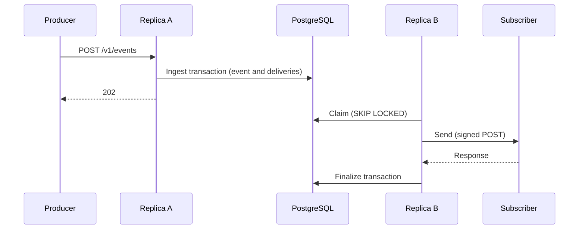

# reliable-webhooks

A webhook delivery service in Java 21 on Spring Boot 4.1 and PostgreSQL 18. A producer posts an event once, and the service sends it as a signed HTTP request to every subscribed endpoint, with retries, dead-lettering and replay. Two things are unusual. PostgreSQL is the queue and the only stateful dependency: there is no broker, and replicas coordinate through the database alone. Every failure claim is tied to a test: each row below links the tests that prove it, and the build fails if a linked test did not run and pass.

## Failure table

Ten rows, cut to their main claims. [docs/failure-table.md](docs/failure-table.md) has all 31 and says how each test forces its failure.

| # | Failure | Proven behaviour | Test |
|---|---|---|---|
| 1 | Worker killed mid-delivery | Redelivered after the lease; attempt 1 `unknown`, attempt 2 `success` | [`WorkerKillIT#killedMidRequest`](src/test/java/io/github/realjoegz/reliablewebhooks/delivery/WorkerKillIT.java) |
| 2 | Crash after subscriber 200, before commit | Exactly two requests with the same `webhook-id`; one `succeeded` | [`WorkerKillIT#killedAfterResponseBeforeCommit`](src/test/java/io/github/realjoegz/reliablewebhooks/delivery/WorkerKillIT.java) |
| 5 | Duplicate submit | One event; same id returned; different body gets 422 | [`IdempotencyIT#sameKeyReturnsSameEvent`](src/test/java/io/github/realjoegz/reliablewebhooks/ingest/IdempotencyIT.java), `#concurrentSameKeyCreatesOneEvent`, `#sameKeyDifferentBodyIsRejected` |
| 6 | Two claims race for one delivery | One claim gets it; the other skips it without waiting | [`ClaimRaceIT#secondClaimerSkipsLockedRow`](src/test/java/io/github/realjoegz/reliablewebhooks/delivery/ClaimRaceIT.java) |
| 8 | Database restart | No delivery lost; the delivery in flight across the restart is recorded once from one request; replicas stay up | [`DatabaseRestartIT#inFlightAndQueuedSurviveRestart`](src/test/java/io/github/realjoegz/reliablewebhooks/DatabaseRestartIT.java) |
| 9 | Endpoint down for hours | Circuit opens after 5 failures; deliveries held behind the open circuit use no attempts; one probe per interval, however many claims run at once | [`EndpointOutageIT#circuitOpensAndHolds`](src/test/java/io/github/realjoegz/reliablewebhooks/delivery/EndpointOutageIT.java), `#oneProbeAdmittedAcrossConcurrentClaimers` |
| 13 | Slow endpoint starving others | At most 4 concurrent requests per replica to it; other endpoints complete meanwhile | [`SlowEndpointIsolationIT#slowEndpointDoesNotDelayOthers`](src/test/java/io/github/realjoegz/reliablewebhooks/delivery/SlowEndpointIsolationIT.java) |
| 16 | Tenant floods ingest | Four replicas together admit exactly the tenant's limit, not four times it; another tenant is served | [`RateLimitIT#limitIsExactAcrossReplicas`](src/test/java/io/github/realjoegz/reliablewebhooks/RateLimitIT.java), `#floodingTenantDoesNotBlockOtherTenant` |
| 18 | Subscriber URL points at, or rebinds to, a private address | Rejected at registration; blocked at connect with zero accepted connections | [`SsrfIT#registrationRejectsPrivateTargets`](src/test/java/io/github/realjoegz/reliablewebhooks/http/SsrfIT.java), `#rebindingIsBlockedAtConnect` |
| 20 | Rolling deploy (SIGTERM) | Nothing is claimed after the poller stopped; in-flight attempts finish and are recorded; the process exits by itself with code 143 | [`GracefulShutdownIT#drainsInFlightAndExits`](src/test/java/io/github/realjoegz/reliablewebhooks/ops/GracefulShutdownIT.java) |

## Run it locally

You need Docker with Compose, `curl` 7.82 or later and `jq`. The stack also needs ports 3000, 9090 and 16686 free on the loopback address, and no other Docker network in 172.28.0.0/24.

```
docker compose up --build --detach --wait
scripts/demo.sh
```

The first command starts PostgreSQL, two replicas, an example subscriber, Prometheus, Grafana and Jaeger. The second walks through the API: a verified delivery, a forged request that the subscriber refuses and a failed attempt that succeeds on its retry. [docs/api.md](docs/api.md) has every route and what a subscriber receives. Then open [Grafana](http://localhost:3000/d/reliable-webhooks), [Prometheus](http://localhost:9090/targets) or [Jaeger](http://localhost:16686). The stack is for development: its credentials are in `compose.yaml`. `docker compose down --volumes` removes it with its data.

## How it works



- **Ingest.** One transaction stores the event and one delivery row per matching endpoint. A repeat under the same `Idempotency-Key` returns the same event.
- **Claim.** Every replica polls. One statement leases due deliveries for 60 seconds under a random token and skips rows that another replica has locked.
- **Send.** An attempt is one `POST`, signed in the Standard Webhooks format, with a 15-second deadline, to public addresses only.
- **Finalize.** One transaction records the outcome. It needs the lease token, so a replica that lost its lease changes nothing.
- **Retry.** Anything but a 2xx is retried with backoff. After twelve attempts or 72 hours a delivery is `dead`, and you can replay it.

## Design decisions

- [PostgreSQL is the queue](docs/design.md#17-rejected-alternatives), not Kafka, SQS or Redis: one store, so no dual write between saving an event and queueing it.
- [Deliveries are written in the ingest transaction](docs/design.md#6-ingest-idempotency-and-transactional-outbox-fan-out), not by a relay over an outbox: no event exists without its deliveries.
- [The lease is the row's due time, fenced by a token](docs/design.md#4-data-model), not an `in_flight` state with a reaper: a dead holder's row comes due by itself.
- [The claim picks endpoints first](docs/design.md#7-delivery-worker-claim-lease-send-finalize), not the oldest due rows: one deep backlog cannot fill a claim.
- [Circuit state lives in PostgreSQL](docs/design.md#9-circuit-breaker), not in each replica: an open circuit holds for every replica and survives a restart.
- [Addresses are checked where the socket connects](docs/design.md#114-ssrf-and-the-outbound-client), through a resolver hook that Apache HttpClient has and the JDK client lacks: a host that rebinds to a private address gets no connection.

[Section 17](docs/design.md#17-rejected-alternatives) has the rest.

## What it does not do

- **No ordering.** Retries, held deliveries and replays reorder deliveries.
- **No exactly-once.** A subscriber can get a delivery twice and must deduplicate on `webhook-id`.
- **No high availability.** PostgreSQL is the single point of failure, and a failover to an asynchronous standby can lose accepted events.
- **No bound on delivery time.** A claim costs more with every active endpoint. With stale planner statistics PostgreSQL can also choose a plan that reads every pending delivery of every tenant, and a backlog then drains slowly until the table is analysed again.
- **No check that a tenant owns an endpoint.** A tenant can aim signed requests at any public host, up to its rate limit.
- **No storage quota.** At the default rate a tenant can store about 16 GiB of event bodies a day.
- **No cloud deployment.** The service has run on one laptop and in CI.

[Section 14](docs/design.md#14-limitations) lists all 38.

## Performance

Measured on one laptop. [docs/performance.md](docs/performance.md) has the method and what limits each number.

- **Ingest.** The 99th percentile of `POST /v1/events` stayed under 100 ms without an error up to 250 events a second in both runs. At 500 a second it was 46.77 ms with one request refused in one run, and 517.26 ms in the other.
- **Delivery.** At 500 events a second over 100 endpoints, the median time from accepting an event to recording its 2xx was 0.016 s, and the 99th percentile was 0.194 s in one run and 0.272 s in the other. One endpoint with a backlog got 1984.2 to 2429.2 deliveries a second from two replicas, and 108.8 to 131.2 until PostgreSQL had analysed the table.
- **Kill.** With one of two replicas killed under 900 deliveries a second, all 36001 accepted events were delivered to each of their three endpoints in both runs. The subscriber received 39 requests twice in one run and 12 in the other.

## How the claims are tested

- **Kills are placed, not timed.** A test runs the packaged jar as a process and kills it at a point that it can see: the replica waits for a lock the test holds, the test's receiver holds the request, or the database shows the commit.
- **Real PostgreSQL.** A replica under test runs against PostgreSQL 18 in a container, with the retry, breaker, lease and timeout settings that ship.
- **Time is aged in the data, not in the clock.** A test that needs a lease, a retry wait or the 72 hours to pass subtracts that interval from the time columns of the row. The service and `now()` run unchanged.
- **The failure-table check.** A linked test that is renamed, disabled, skipped or failing fails the build. Old test reports are deleted first, so an earlier run cannot count.

## Deploying

[docs/deploy.md](docs/deploy.md) describes the Helm chart in `deploy/helm`, which CI installs on a kind cluster, and what a rollout means for database migrations.

It also describes the Terraform module in `infra/terraform` for EKS and PostgreSQL on RDS, which CI validates and plans against a mocked provider. It has never been applied.

## Repository

- `src`: the service and its tests, with their harness and `FailureTableCheck`.
- `docs`: the documents, indexed in [docs/README.md](docs/README.md).
- `compose.yaml`, `observability`, `examples`, `scripts`: the local stack, its demo and the checks that CI runs.
- `deploy`, `infra`, `loadtest`: the Helm chart, the Terraform module and the load tests.

To read the code, start with [`V1__schema.sql`](src/main/resources/db/migration/V1__schema.sql) (the data model), [`DeliveryRepository`](src/main/java/io/github/realjoegz/reliablewebhooks/delivery/DeliveryRepository.java) (the claim and the fenced finalize, as SQL), [`DeliveryWorker`](src/main/java/io/github/realjoegz/reliablewebhooks/delivery/DeliveryWorker.java) (one attempt) and [`WorkerKillIT`](src/test/java/io/github/realjoegz/reliablewebhooks/delivery/WorkerKillIT.java) (how a kill is placed).

## Build and test

```
./mvnw verify
```

You need JDK 21 and Docker. This runs the unit and integration tests, the format check and the failure-table check. To run one class, use `./mvnw test -Dtest=ProblemsTest` or `./mvnw verify -Dit.test=AdminApiIT -DfailureTable.skip=true`. `./mvnw spotless:apply` formats the sources.

## License

Apache License 2.0. See [LICENSE](LICENSE).
